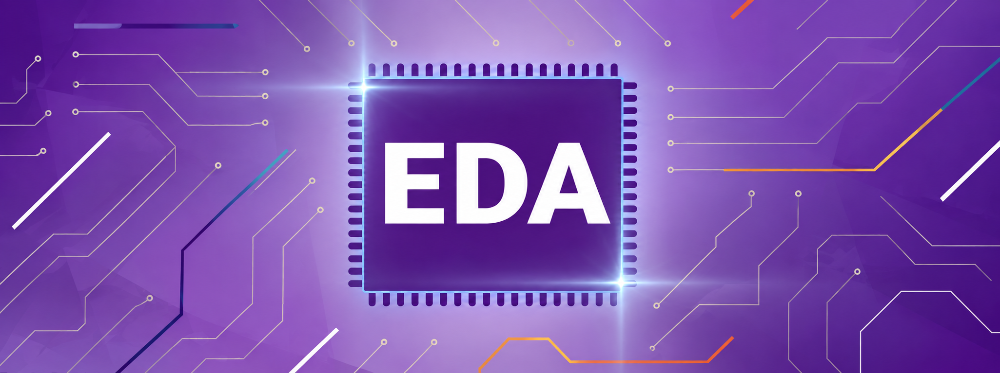

# EDA Design Flow Integration

## Labs

Labs | Description
--------|:-----
[W2 Lab][1] | Warmup: RTL and Verification Fundamentals
[W3 Lab][2] | Combinational 3-tap FIR Filter
[W4 Lab][3] | Sequential 3-tap FIR Filter
[W5 Lab][4] | FIR Filter: Parallelism and Pipelining
[W6 Lab][5] | FIR Filter: FPGA Synthesis Options, Phases, and Reports
[W7 Lab][6] | FIR Filter: FPGA Implementation Phases and Reports
[W8 Lab][7] | FIR Filter: PYNQ-Z2 FPGA Bring-up
[W10 Lab][8] | FIR Filter: Cell-based Synthesis Phases and Reports

[1]: labs/w02/
[2]: labs/w03/
[3]: labs/w04/
[4]: labs/w05/
[5]: labs/w06/
[6]: labs/w07/
[7]: labs/w08/
[8]: labs/w10/

