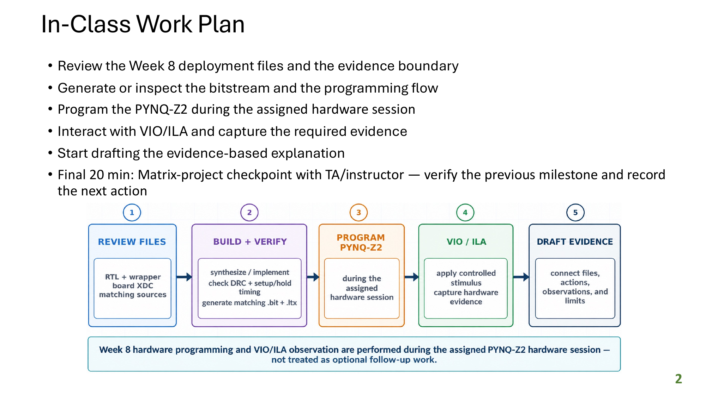
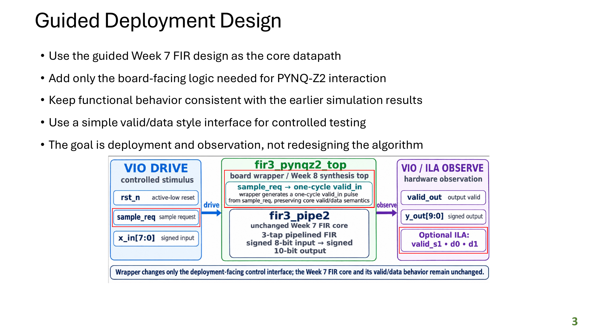
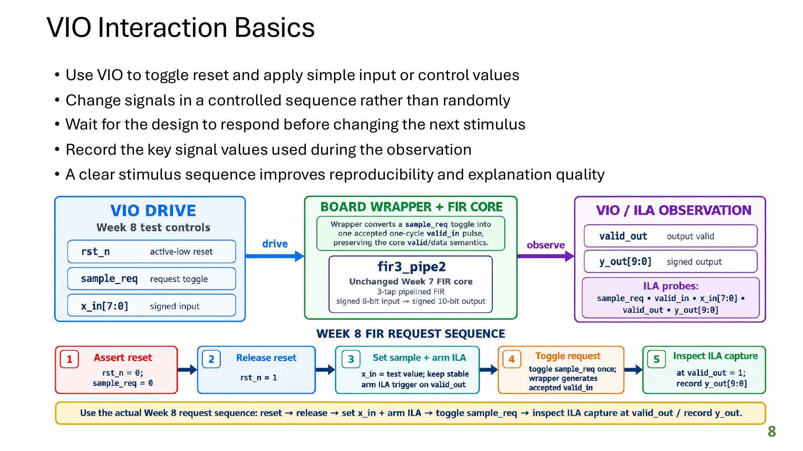
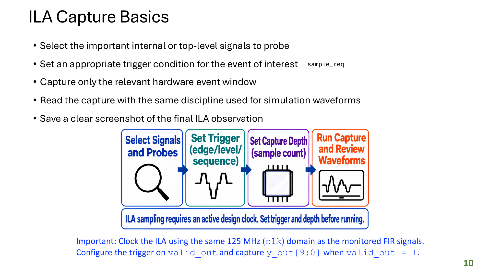
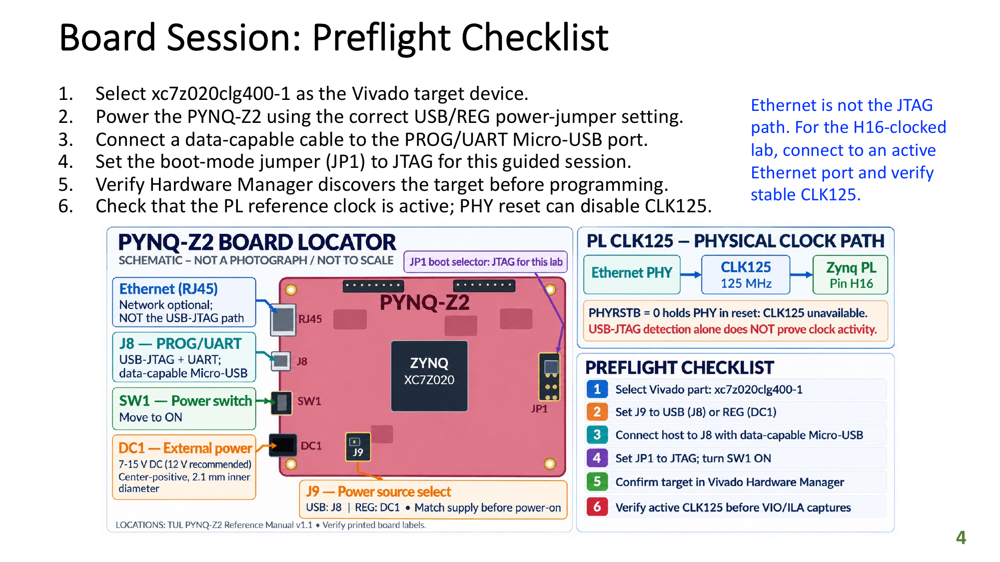
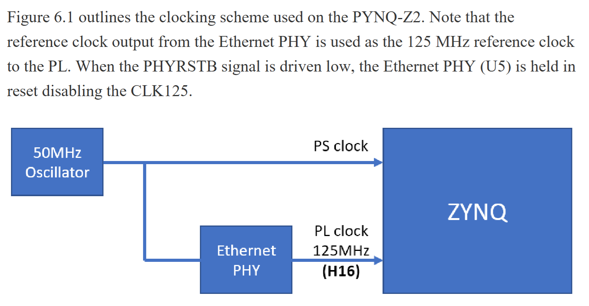
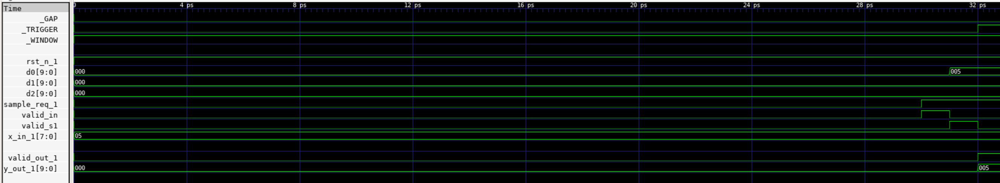

# Week 8. FIR Filter: PYNQ-Z2 FPGA Bring-up

## 1. Introduction

Week 8 continues the FIR filter theme throughout the FPGA flow by reusing the pipelined three-tap FIR design developed in previous weeks. For PYNQ-Z2 deployment, `fir3_pipe2_debug.v` preserves the FIR computation while exposing the internal `valid_s1`, `d0`, `d1`, and `d2` pipeline state for ILA observation. `fir3_debug_wrapper.v` converts a VIO-held `sample_req` level into a single-cycle `valid_in` pulse on each LOW-to-HIGH transition, and `fir3_pynqz2_top.v` connects the wrapped FIR to the board clock, VIO, and ILA.

VIO provides hardware control for reset, sample request, and input data, while ILA observes the request, FIR pipeline, internal state, and output during board bring-up. The flow generates a `.bit` bitstream and matching `.ltx` debug-probes file, programs the PYNQ-Z2 through USB-JTAG, and captures the FIR response and internal pipeline activity for hardware inspection.

## 2. Reproduction Flow

<p>
  
</p>

```bash
$ ./run.sh                  # complete simulation, build, and programming flow
```

Alternatively, run the entire flow step-by-step

```bash
$ ./run.sh sim              # FIR regressions followed by the Week 8 wrapper regression
$ ./run.sh build            # simulations, then fresh 8 ns board implementation + .bit + .ltx
$ ./run.sh program          # only at the assigned powered PYNQ-Z2 hardware session
```

Requires AMD Vivado with `vivado`, `xvlog`, `xelab`, and `xsim` on `PATH`. Hardware programming additionally requires a powered board and data-capable USB cable on J8 PROG/UART (USB-JTAG). The Ethernet PHY's `CLK125` must be active for VIO/ILA at 125 MHz (H16).

## 3. Deployment-ready Design

### 3.1 RTL Hierarchy

<p>
  
</p>

Week 8 takes the pipelined three-tap FIR filter developed in the earlier weeks and prepares it for physical PYNQ-Z2 deployment. The FIR arithmetic is preserved, while the Week 8 design adds debug visibility into the pipeline, converts a VIO request into a single accepted sample, and connects the result to VIO/ILA through a board-level wrapper. The table below shows how the four RTL files implement those layers.

| RTL file | Role | Relationship to the next layer |
|---|---|---|
| `rtl/fir3_pipe2.v` | Standalone two-stage, three-tap FIR reference | Preserved as the original arithmetic source; it is not modified for deployment. |
| `rtl/fir3_pipe2_debug.v` | Debug derivative of the FIR | Preserves the FIR behavior and exposes `valid_s1`, `d0`, `d1`, and `d2` for ILA observation. |
| `rtl/fir3_debug_wrapper.v` | One-shot request wrapper | Converts a VIO-held `sample_req` level into one `valid_in` pulse and instantiates the debug FIR core. |
| `rtl/fir3_pynqz2_top.v` | PYNQ-Z2 synthesis top | Instantiates the wrapper, VIO, and ILA, and exposes the board-level `clk` input. |

### 3.2 Hardware Stimulus Generator (VIO) and Logic Analyzer (ILA)

<p>
  
  
</p>

VIO and ILA are Vivado debug cores used together during physical FPGA bring-up. VIO provides interactive control and observation through the JTAG connection: it drives the FIR reset, sample request, and signed input sample, while also reporting the output-valid signal and FIR result. ILA captures clocked signal activity inside the FPGA so the request, input, pipeline-valid signals, internal sample history, and output can be inspected over time.

Their roles are complementary. VIO supplies controlled stimulus to the design, and ILA records the resulting hardware behavior. Both cores use the same board clock and are connected in `rtl/fir3_pynqz2_top.v`; the matching `.ltx` file allows Vivado Hardware Manager to identify and interpret their probes after the `.bit` file is programmed.

The relationship between the build script and the board-level RTL enables the generated debug IP. [vivado/build.tcl](./vivado/build.tcl) creates the `vio_fir3` and `ila_fir3` IP cores, assigns their probe counts and widths, generates their output products, and adds them to the Vivado project. `rtl/fir3_pynqz2_top.v` then instantiates those generated modules by name and connects their probes to the FIR reset, sample request, input sample, output, valid signals, and internal history registers. The top-level RTL provides the connections, while [build.tcl](./vivado/build.tcl) provides the IP definitions and generated implementation files needed for Vivado to compile the design.

The ILA is configured to capture the following signals. These probes provide visibility into the complete transaction, from the VIO-generated request and input sample through the FIR pipeline and final result:

| probe | signal | width |
|---|---|---|
| 0 | `rst_n` | 1 |
| 1 | `sample_req` | 1 |
| 2 | `x_in` | 8 signed |
| 3 | `valid_in` | 1 |
| 4 | `valid_out` | 1 |
| 5 | `y_out` | 10 signed |
| 6 | `valid_s1` | 1 |
| 7–9 | **actual** `d0`, `d1`, `d2` registers from the original Week 6 core | **10 signed bits each** |

### 3.3 Clock Configuration

<p>
  
  
</p>

The PYNQ-Z2 uses a 50 MHz oscillator as the Zynq processing-system clock source. The Ethernet PHY derives and outputs a separate 125 MHz reference clock to the programmable logic on H16, allowing the PL to operate independently of the PS clock. Because the PHY supplies this PL clock, driving `PHYRSTB` low holds the PHY in reset and disables `CLK125`; the board must therefore provide an active PHY clock before the design can run reliably.

The clock relationship is defined by the board constraint file. The table below traces the clock from the RTL port through FPGA pin H16 to the PYNQ-Z2 Ethernet PHY.

| Design item | File | Definition | Meaning |
|---|---|---|---|
| RTL clock port | `rtl/fir3_pynqz2_top.v` | `input wire clk` | Clock used by the wrapper, VIO, and ILA. |
| FPGA package pin | `constraints/fir3_pynqz2.xdc` | `PACKAGE_PIN H16` | Maps the logical `clk` port to physical FPGA pin H16. |
| Clock timing | `constraints/fir3_pynqz2.xdc` | `create_clock -period 8.000` | Constrains the clock as 125 MHz. |
| PYNQ-Z2 board wiring | PYNQ-Z2 board schematic | H16 is connected to the Ethernet PHY's `CLK125` output | The PHY must be powered and out of reset, with active `CLK125`, for the clocked design to operate reliably. |

The XDC does not create an Ethernet clock; it maps the RTL clock port to the board's PHY-generated clock connection.

## 4. Bitstream and Debug Probes Build

[vivado/build.tcl](./vivado/build.tcl) runs the non-hardware portion of the flow. It creates the Vivado project, generates the debug IP, synthesizes and implements the design, validates the result, and produces the files required for programming.

| Build stage | Important commands or operations | Result |
|---|---|---|
| Initialize and validate | Resolves `$root`, defines source/output paths, creates output directories, and checks that the RTL and XDC files exist. | A complete source snapshot and known output locations. |
| Create project and add sources | `create_project`, `add_files`, `add_files -fileset constrs_1`, and `set_property top`. | A fresh XC7Z020 project using `fir3_pynqz2_top` and the board constraints. |
| Generate VIO IP | `create_ip -name vio`, configures probe counts/widths, then runs `generate_target` and `export_ip_user_files`. | The generated `vio_fir3` module used for hardware stimulus and status observation. |
| Generate ILA IP | `create_ip -name ila`, configures ten probes, then runs `generate_target` and `export_ip_user_files`. | The generated `ila_fir3` module used to capture FIR activity and internal history. |
| Update and synthesize | `update_compile_order -fileset sources_1`, `launch_runs synth_1`, and synthesis report commands. | Synthesized design plus synthesis utilization and timing reports. |
| Implement and checkpoint | Runs implementation through routing and executes `write_checkpoint`. | Routed design checkpoint at `checkpoints/fir3_pynqz2_routed.dcp`. |
| Validate implementation | Generates timing, utilization, route, clock, power, DRC, and methodology reports; checks the 125 MHz clock, setup/hold paths, timing slack, and blocking DRCs. | Only a design passing the required implementation checks proceeds to handoff generation. |
| Generate handoff files | Completes `write_bitstream`, copies the `.bit`, and runs `write_debug_probes`. | `artifacts/fir3_pynqz2.bit` and matching `artifacts/fir3_pynqz2.ltx`. |
| Accept handoff | Verifies that the `.bit`, `.ltx`, and `.dcp` files exist and are non-empty. | `WEEK8_BOARD_HANDOFF_ACCEPTED` when the programming package is complete. |

## 5. FPGA Programming

[vivado/program.tcl](./vivado/program.tcl) operates on the physical PYNQ-Z2 after the build handoff exists. It programs the FPGA, applies a controlled FIR stimulus through VIO, captures the response with ILA, and saves hardware evidence.

| Programming stage | Important commands or operations | Result |
|---|---|---|
| Initialize hardware session | Resolves the artifact paths, checks the `.bit` and `.ltx`, opens Hardware Manager, connects to the hardware server, and selects the XC7Z020 device. | A validated USB-JTAG connection to the target board. |
| Program and load debug metadata | Sets `PROGRAM.FILE` to the `.bit`, sets `PROBES.FILE` to the `.ltx`, runs `program_hw_devices`, and refreshes the device. | The FPGA is configured and Hardware Manager can identify the VIO/ILA probes. |
| Discover VIO and ILA | Retrieves the hardware VIO/ILA objects and prints their probe information. | The script confirms that both debug cores are present in the programmed design. |
| Apply FIR stimulus | Uses `set_property OUTPUT_VALUE` and `commit_hw_vio` to assert reset, release reset, set `x_in = 5`, and raise `sample_req`. | One controlled FIR sample is submitted through the VIO interface. |
| Configure and run capture | Resets the ILA, sets a 1024-sample depth and trigger position, triggers on `valid_out`, and starts the capture. | The FIR transaction and response are recorded in the FPGA. |
| Retrieve and export evidence | Waits for completion, uploads the ILA data, and writes `.ila`, `.csv`, and `.vcd` files under `evidence/`. | Reusable waveform evidence plus the reported `y_out` value. |

## 6. Result

The timing, utilization, and power results in this section are heavily influenced by the generated VIO and ILA IP cores, their debug hub, and associated JTAG infrastructure. The FIR filter itself is a small three-tap datapath, so the reported implementation cost and timing behavior represent the complete debug-enabled Week 8 design rather than the FIR arithmetic alone.

### 6.1 VIO-Driven Debug Waveform

<p>
  
</p>

The waveform shows one controlled FIR transaction. The input `x_in` is set to `05` while reset is inactive, and a rising edge on `sample_req` produces a single-cycle `valid_in` pulse. The pipeline then asserts `valid_s1`, updates the first delay register `d0` to `005`, and later asserts `valid_out` with `y_out` equal to `005`. The remaining delay registers stay at zero for this first sample, which matches the expected two-stage FIR pipeline behavior and confirms that the request, internal state, valid signals, and result are aligned.

### 6.2 DRC, Methodology, and Route-Status Reports

| Report file | Observation |
|---|---|
| [impl_drc.rpt](./reports/impl_drc.rpt) | Five checks were reported, all as warnings rather than errors: three LUT equation warnings, one no-routable-load warning, and one warning that the Zynq PS7 block is not used. |
| [impl_methodology.rpt](./reports/impl_methodology.rpt) | Six warnings were reported: four about debug-hub LUTs driving asynchronous resets and two about inefficient pin queries in generated ILA constraints. These warnings originate in generated debug infrastructure and ILA constraints, not the FIR RTL itself. |
| [impl_route_status.rpt](./reports/impl_route_status.rpt) | All 3,770 routable nets are fully routed, with zero nets having routing errors. The design is physically routed with no blocking DRC or routing errors, although the generated debug-IP warnings should be documented. |

### 6.3 Timing Reports

The [post-synthesis timing summary](./reports/synth_timing_summary.rpt) and [post-implementation timing summary](./reports/impl_timing_summary.rpt) both analyze the constrained 125 MHz `clk` with an 8.000 ns period. The design timing summary comparison is:

| Report | WNS | TNS | WHS | THS | WPWS | TPWS |
|---|---:|---:|---:|---:|---:|---:|
| [synth_timing_summary.rpt](./reports/synth_timing_summary.rpt) | 3.079 ns | 0.000 ns | 0.045 ns | 0.000 ns | 3.020 ns | 0.000 ns |
| [impl_timing_summary.rpt](./reports/impl_timing_summary.rpt) | 1.838 ns | 0.000 ns | 0.028 ns | 0.000 ns | 2.750 ns | 0.000 ns |

The routed implementation has less positive setup, hold, and pulse-width slack than synthesis, as expected after physical delays are included, but all timing violations remain zero. The implementation therefore meets the 125 MHz timing constraint.

### 6.4 Utilization Reports

The [post-synthesis utilization report](./reports/synth_utilization.rpt) and [post-implementation utilization report](./reports/impl_utilization.rpt) show the resource cost of the FIR design together with the generated VIO, ILA, and debug infrastructure. The important resource comparison is:

| Report | LUT as Logic | LUT as Memory | Slice Registers | DSPs | BUFGCTRL clock buffers | Bonded IOBs | Unique control sets |
|---|---:|---:|---:|---:|---:|---:|---:|
| [synth_utilization.rpt](./reports/synth_utilization.rpt) | 1,054 (1.98%) | 178 (1.02%) | 2,093 (1.97%) | 0 (0.00%) | 1 (3.13%) | 1 (0.80%) | 76 (0.57%) |
| [impl_utilization.rpt](./reports/impl_utilization.rpt) | 1,467 (2.76%) | 177 (1.02%) | 2,800 (2.63%) | 0 (0.00%) | 2 (6.25%) | 1 (0.80%) | 141 (1.06%) |

The post-implementation design uses more LUTs, registers, clock buffers, and control sets because the generated VIO, ILA, and debug hub are included in the implemented hardware. The FIR datapath uses no DSP blocks; BRAM and URAM are omitted from this focused summary because they are not part of the FIR datapath resource discussion.

### 6.5 Power Reports

The [post-implementation power estimate](./reports/impl_power_estimate.rpt) reports the following values for the routed design:

| Power metric | Reported value |
|---|---:|
| Total on-chip power | 0.124 W |
| Dynamic power | 0.021 W |
| Device static power | 0.103 W |
| Junction temperature | 26.4 °C |
| Maximum ambient temperature | 83.6 °C |
| Confidence level | Medium |

Static power is the largest component of the estimate, accounting for 0.103 W compared with 0.021 W of dynamic power. Within the design hierarchy, the ILA contributes an estimated 0.014 W, the debug hub 0.004 W, and VIO 0.003 W. The estimate has medium confidence because no simulation activity file was supplied and less than 25% of internal-node activity was specified, so the values should be treated as an implementation estimate rather than a measured board-power result.

## 7. Conclusion

Week 8 extends the earlier three-tap FIR design into a complete PYNQ-Z2 deployment flow. The design meets the 125 MHz target after implementation with 1.838 ns WNS, 0.028 ns WHS, and zero total setup, hold, and pulse-width violations. All 3,770 routable nets are fully routed with zero routing errors, while the implemented design uses 1,467 LUTs, 2,800 registers, and 0 DSPs. The final power estimate is 0.124 W, including 0.021 W dynamic power, demonstrating that the debug-enabled FIR remains a small and practical design for the target board.

VIO and ILA also provide a reusable pattern for future FPGA deployments. VIO can supply controlled reset, configuration, and test inputs through JTAG without requiring additional physical pins, while ILA can capture internal control signals, pipeline stages, and outputs at the design clock rate. Together, they make it possible to bring up a new hardware design incrementally, compare observed behavior with simulation, diagnose timing or control issues, and collect repeatable evidence before integrating a larger software or system-level test environment.
