# Week 12. Floorplanning, Power Planning, Placement, and Pre-CTS Hold Repair with ICC2

## 1. Introduction

This lab uses Synopsys IC Compiler II (ICC2) to take a mapped three-tap FIR design through floorplanning, power planning, standard-cell placement, and a targeted hold repair. The experiments show how core utilization affects placement space, how cells connect to the power grid, how placement affects routing congestion, and how a hold fix trades setup margin for hold margin.

The lab ends with a placed checkpoint. ICC2 uses global routing only to estimate congestion. The timing analysis assumes zero interconnect delay because the lab uses no RC extraction model. Clock tree synthesis (CTS), detailed signal routing, IR drop, electromigration, foundry DRC/LVS, special-cell requirements, and formal equivalence are outside the scope of the lab.

## 2. Quick Start

```bash
bash run.sh
```

After building the reference library, `run.sh` runs the five ICC2 steps below in order.

| ICC2 Stage | What It Does |
| --- | --- |
| `floor` | Imports the mapped FIR netlist and creates two floorplans with 60% and 50% target utilization. |
| `rails` | Builds standard-cell power and ground rails on the 60% floorplan for a connectivity check. |
| `place` | Builds the power mesh on the 50% floorplan, then runs ordinary and congestion-driven placement and legalizes both. |
| `hold` | Compares the ordinary placement before and after inserting one buffer on the `valid_out` path to improve hold slack. |
| `reopen` | Verifies the final checkpoint for Week 13 by reopening a copy of the hold-optimized design and rerunning physical checks. |

See [Lab Files and Usage](docs/files_and_usage.md) for file locations and commands, [Lab Automation](docs/automation.md) for execution order and checkpoint dependencies, and [Reference Results](docs/REFERENCE_RESULTS.md) for an example run.

## 3. Floorplan Inputs

The overview shows how ICC2 uses standard-cell libraries, technology data, and a mapped netlist to build a design library (`ORCA.dlib` holds the example ORCA design) [1]. In this lab, the design library is `fir3.dlib`, and ICC2 creates the floorplan using Tcl.

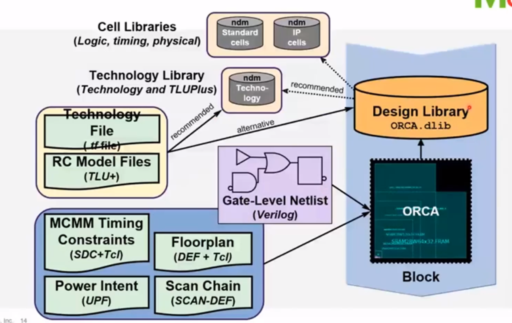

### 3.1 NDM Reference Library

<p>
  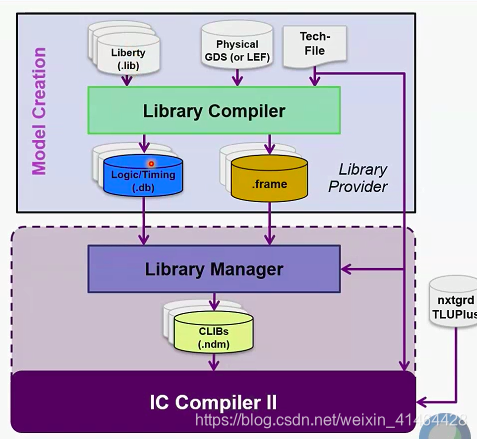
  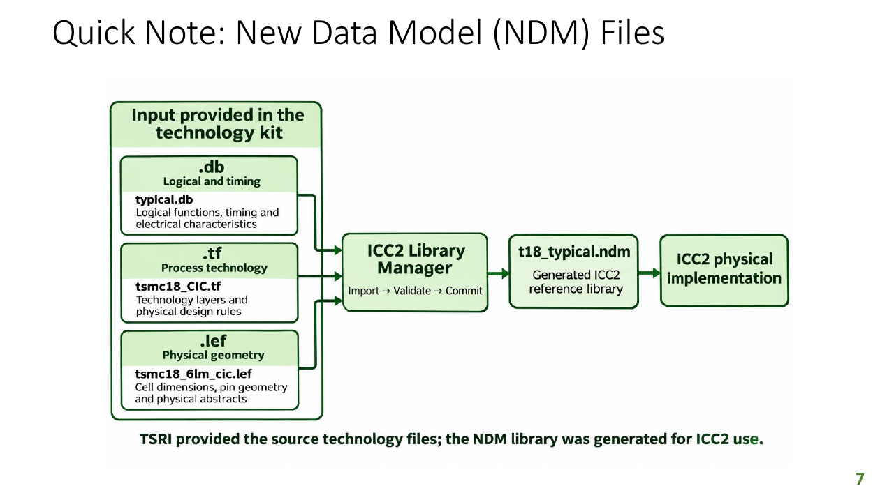
</p>

The Synopsys New Data Model (NDM) reference library supplies the standard-cell timing models, dimensions, and pin geometry that ICC2 uses during physical design. In this lab, `bash run.sh` launches Synopsys Library Manager before floorplanning. The [build script](tcl/0_build_reference_library.tcl) creates a workspace with the T18 technology file `tsmc18_CIC.tf`, reads timing and logical cell data from `typical.db`, and reads physical cell data from `tsmc18_6lm_cic.lef`. Library Manager validates the workspace with `check_workspace` and writes the NDM with `commit_workspace`. The runner publishes the library to [input/t18_typical.dnm/](input/t18_typical.dnm/) and keeps build diagnostics in `output/0_build_reference_library/`.

### 3.2 Netlist

This lab reuses the synthesized Week 10 `fir3_reference` design for a 3-tap FIR filter. Before creating the two floorplans, ICC2 imports [the mapped Verilog](input/mapped.v) and matches each cell instance to its definition in the T18 reference library.

## 4. Experiments

### 4.1 A: Floorplan Utilization

<p>
  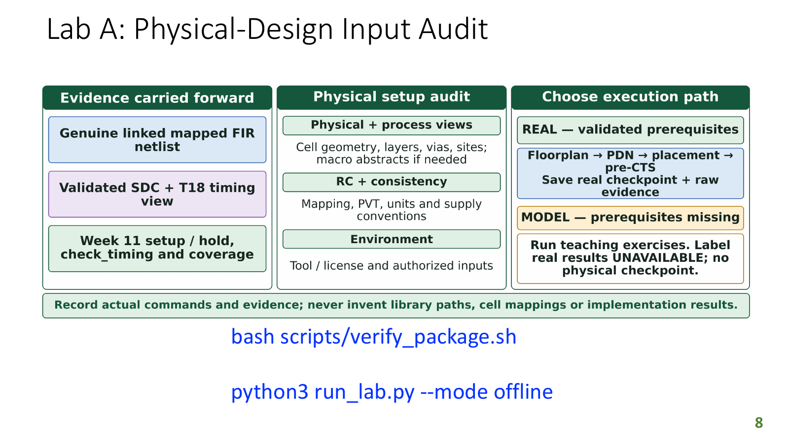
  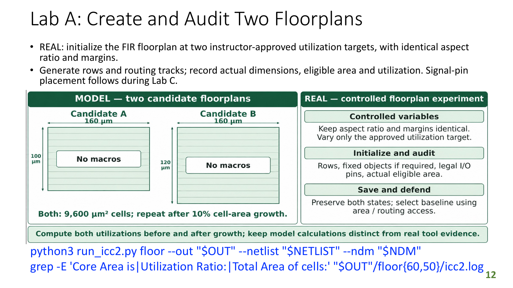
</p>

In Experiment A, two floorplans are built for the same FIR design at target utilizations of 60% and 50%. The aspect ratio and margins are held constant. The resulting core dimensions, placement rows, and site occupancy are compared to see how the utilization target affects the space available for the same set of cells.

### 4.2 B: Power Grid Connectivity

<p>
  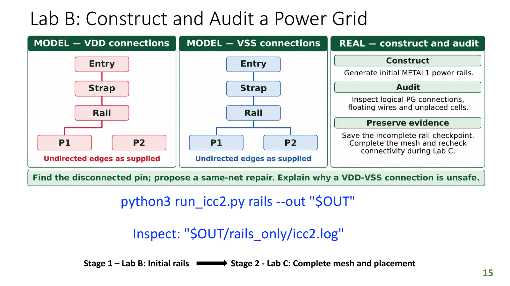
  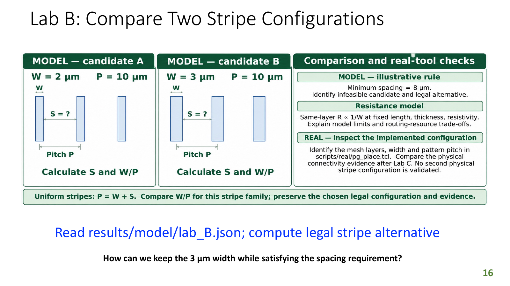
</p>

In Experiment B, a rails-only power grid is built and compared with the complete mesh used in Experiment C. The connections from the supply entry points to the cell pins are traced through straps, vias, and rails, and connectivity is checked before and after placement. The 0.84 µm mesh widths, 20 µm pattern pitch, 3 µm offsets and layers METAL1–3 are teaching choices tested with ICC2 PG DRC and connectivity, not foundry-certified PDN settings. In the simplified exercise, a disconnected pin is identified and the effects of stripe width and pitch on metal coverage and spacing are examined.

In [student_work/power_grid_edges.json](student_work/power_grid_edges.json), each pair describes an undirected connection. Find the disconnected supply pin and add an edge between nodes on the same supply net. Rerun the offline audit with `python3 scripts/run_lab.py --lab B` and review the candidate connectivity audit.

<p>
  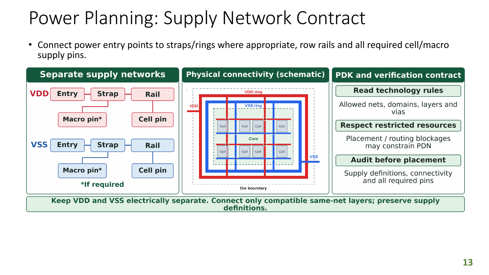
  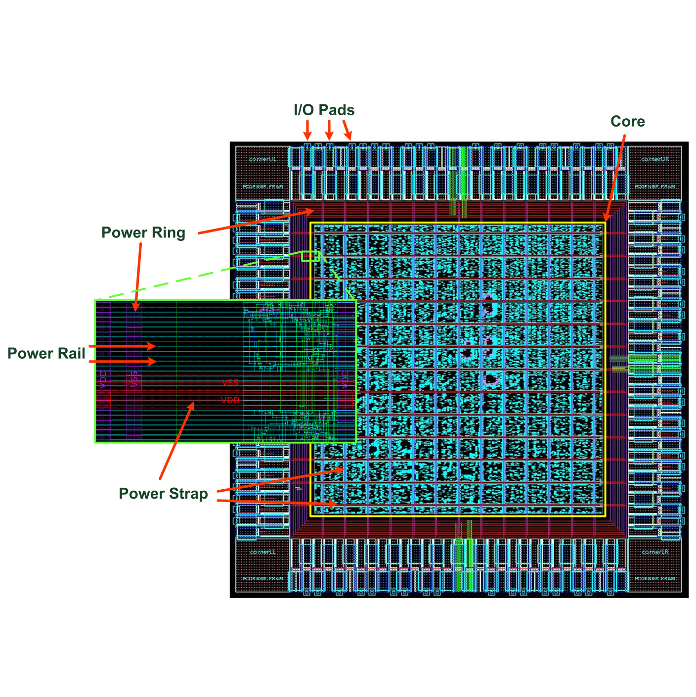
</p>

### 4.3 C: Placement and Routing Congestion

<p>
  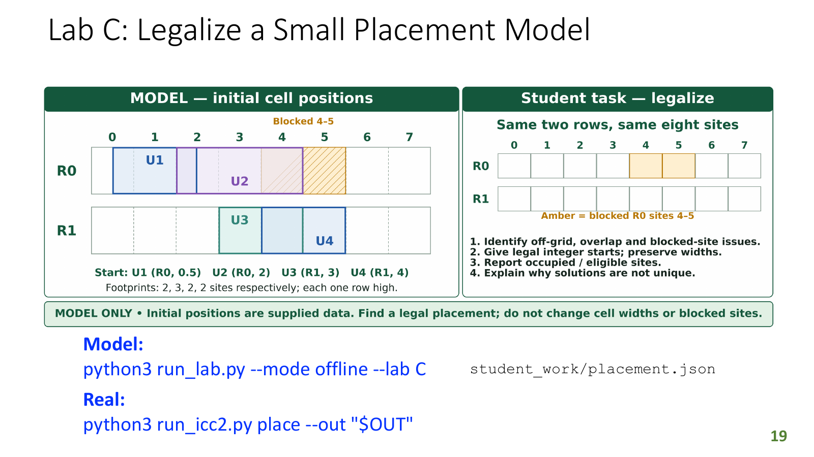
  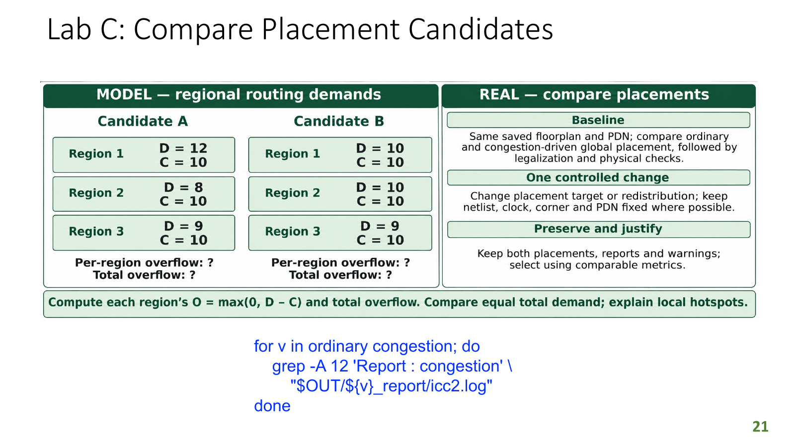
</p>

In Experiment C, a small placement is legalized by aligning cells to sites, avoiding blocked sites, and eliminating overlaps. Ordinary and congestion-driven placements are then compared on the same 50% floorplan with identical power-grid and pin constraints. The final congestion estimates are used to identify where routing demand exceeds capacity and whether one strategy leaves less overflow.

In [student_work/placement.json](student_work/placement.json), each cell’s position is written as `[row, start_site]`. Keep U1–U4 and their existing widths. Use integer start sites and keep each cell within its row, clear of other cells and blocked sites 4–5 in R0. Rerun the offline audit with `python3 scripts/run_lab.py --lab C` and check whether the candidate is legal.

### 4.4 D: Pre-CTS Hold Repair

<p>
  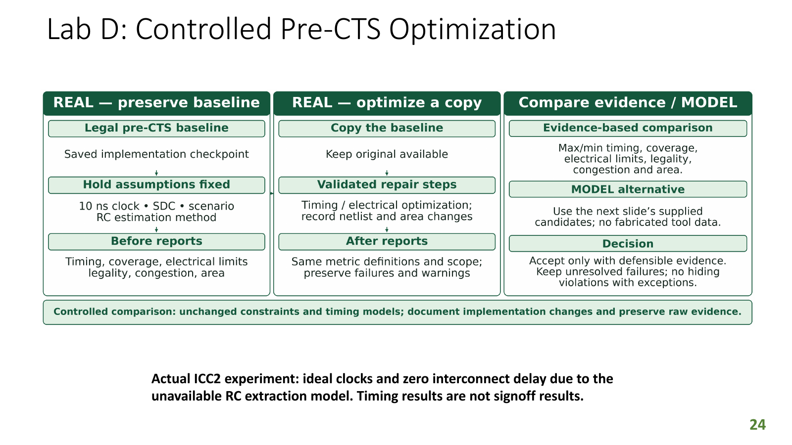
  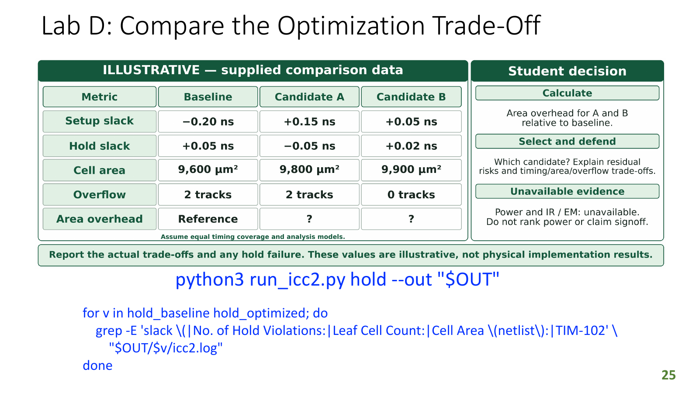
</p>

In Experiment D, a single buffer is added on the path to `valid_out` in a copy of the placed design. The resulting timing is compared with that of the original placement. Changes in hold slack and setup margin are measured with an ideal clock and zero interconnect delay. Timing coverage, cell area, placement legality, power-grid connectivity, and congestion are checked to assess the trade-off.

## 5. IC Compiler 2

The tables follow the operations in execution order. In the logs, `W12_BEGIN` and `W12_END` bracket individual operations. ICC2 prints its own progress messages and report headings within those blocks. `EXECUTED_REVIEW_REQUIRED` indicates that execution and artifact checks completed. Review the reports for violations and gaps in coverage.

### 5.1 Reference Library Build

Inspect [Build Log](output/0_build_reference_library/icc2.log) · [Workspace Diagnostics](output/0_build_reference_library/check_workspace.ems)

| Build Stage | Important Commands or Operations | Result |
| --- | --- | --- |
| Create the workspace | `create_workspace -technology` | A Library Manager workspace with the process technology loaded. |
| Load the cell views | `read_db`, `read_lef` | Logical, timing, and physical cell data in the same workspace. |
| Validate and commit | `check_workspace`, `commit_workspace` | Workspace diagnostics and an NDM reference library ready for ICC2 to load. |

In this build, `TECH-002` flags legacy layer attributes that were ignored, and `LEFR-050` flags LEF via-generation rules that were skipped. Check which entries were affected in the build output.

### 5.2 A: Floorplan Utilization

Inspect [60% Floorplan Log](output/1_A_create_floorplans/floor60/icc2.log) · [50% Floorplan Log](output/1_A_create_floorplans/floor50/icc2.log)

| Floorplan Stage | Important Commands or Operations | Result |
| --- | --- | --- |
| Create and link the design | `create_lib`, `read_verilog`, `link_block` | The mapped netlist is loaded and its cells are resolved against the reference library. |
| Initialize the floorplan | `initialize_floorplan` | Core geometry and placement rows based on the sizing constraints. |
| Report and save | `report_design -floorplan`, `report_utilization`, `save_block`, `write_def` | The actual core dimensions and utilization, a native checkpoint, and a DEF export. |

Compare actual utilization with the requested target. In this run, `DPUI-924` reports that ICC2 inferred routing directions for layers with no explicit direction.

### 5.3 B: Power Grid Connectivity

Inspect [Rails-Only Log](output/2_B_build_cell_rails/icc2.log) · [Full-Mesh and Placement Log](output/3_C_place_cells/ordinary/icc2.log)

| Power Grid Stage | Important Commands or Operations | Result |
| --- | --- | --- |
| Connect supply pins | `connect_pg_net` | Logical associations between cell supply pins and power and ground nets. |
| Generate the rails | Define a rail pattern and strategy, then run `compile_pg`. | Physical rail shapes in the floorplan. |
| Check geometry and connectivity | `check_pg_drc`, `check_pg_connectivity` | Geometry violations and counts of floating wires, cells, and other objects. |

A grid can pass its geometry checks while reporting floating cells. Compare the rails-only design with the full mesh before and after placement to see when physical connections to the cells are established.

### 5.4 C: Placement and Routing Congestion

Inspect [Placement Log](output/3_C_place_cells/ordinary/icc2.log) · [Ordinary Congestion Log](output/3_C_place_cells/ordinary_report/icc2.log) · [Congestion-Driven Log](output/3_C_place_cells/congestion_report/icc2.log)

| Placement Stage | Important Commands or Operations | Result |
| --- | --- | --- |
| Prepare the floorplan | `read_sdc`, compile the power mesh and rails, then `place_pins`. | A constrained design with a power grid and signal-pin locations. |
| Place cells globally | `create_placement`, with `-congestion` for congestion-driven placement. | Initial cell locations for the selected strategy. |
| Legalize and check | `legalize_placement`, `connect_pg_net`, `check_legality` | Cells moved onto legal sites, with displacement and legality reported. |
| Estimate routing congestion | `report_congestion -rerun_global_router` | A final table with total overflow, maximum local overflow, and the number of affected global routing cells (GRCs). |

The `Start GR phase` messages mark internal routing passes. Use the final `Report : congestion` table to compare how much demand exceeds capacity and how widely it is distributed.

### 5.5 D: Pre-CTS Hold Repair

Inspect [Baseline Log](output/4_D_repair_hold/hold_baseline/icc2.log) · [Optimized Log](output/4_D_repair_hold/hold_optimized/icc2.log) · [Reopen Log](output/5_reopen_checkpoint/icc2.log)

| Timing Stage | Important Commands or Operations | Result |
| --- | --- | --- |
| Repair the short path | `add_buffer`, `legalize_placement`, `connect_pg_net` | Extra delay on the selected path and a legalized placement with supply connections restored. |
| Update and compare timing | `update_timing`, `report_timing -delay_type min`, `report_timing -delay_type max` | Hold and setup slack for comparing the original and repaired designs. |
| Check timing coverage | `check_timing` | Endpoints and inputs that need constraint review. |
| Save and reopen | `save_block`, then `open_lib` and `open_block` in a fresh session. | A checkpoint that can be loaded again for placement and power-grid checks. |

In this run, `TIM-102` reports that timing uses zero interconnect delay. `TCK-001` flags 25 unconstrained reset endpoints, and `TCK-012` flags a missing clock-relative input delay for `rst_n`. Read slack together with these timing assumptions and coverage warnings.

## 6. Results

### 6.1 A: Floorplan Utilization

Inspect [output/1_A_create_floorplans/](output/1_A_create_floorplans/)

| Metric | 60% Target | 50% Target |
| --- | ---: | ---: |
| Actual Utilization | 61.99% | 53.12% |
| Core Area (µm²) | 5,837.832 | 6,812.467 |
| Cell Area (µm²) | 3,619.1232 | 3,619.1232 |

**Observations**:

- The 50% target produced a larger core for the same cells, leaving more space available for placement.
- Actual utilization exceeded both targets. Use the reported geometry and utilization when comparing the floorplans.

### 6.2 B: Power Grid Connectivity

Inspect [output/2_B_build_cell_rails/](output/2_B_build_cell_rails/)

| ICC2 Power-Grid Check | Rails Only | Full Mesh Before Placement | Full Mesh After Legalization |
| --- | ---: | ---: | ---: |
| Floating Wires per Supply | 7 | 0 | 0 |
| Floating Standard Cells per Supply | 104 | 104 | 0 |
| Reported Power-Grid DRC Errors | 0 | 0 | 0 |

**Observations**:

- The rails-only case had floating wires. The full-mesh case reported zero floating wires before placement and zero floating cells after legalization.
- The edit to `power_grid_edges.json` is correct. Adding the connection from `VDD.rail` to `VDD.P2` changes the offline report’s `student_candidate.disconnected_pins` from one pin to an empty list and sets `connected_without_cross_supply_edges` to `true`. The report’s built-in `initial` case still shows the missing connection.
- The JSON edit affects the offline connectivity audit only. ICC2 builds its power grid from the Tcl flow.

### 6.3 C: Placement and Routing Congestion

Inspect [output/3_C_place_cells/](output/3_C_place_cells/)

| ICC2 Placement Metric | Ordinary | Congestion-Driven |
| --- | ---: | ---: |
| Placement Legality Violations | 0 | 0 |
| Average Legalization Displacement (µm) | 1.392 | 1.434 |
| Final Total Routing Overflow | 1 | 2 |
| Maximum Local Overflow | 1 | 1 |
| Affected Global Routing Cells | 1 | 2 |

**Observations**:

- Both placements were legal. Ordinary placement had lower final routing overflow in this run and was used as the starting point for hold repair.
- The edit to `placement.json` is correct. The offline report’s `student_candidate` has `legal: true` and an empty `issues` list. The built-in `initial` case still reports off-grid placement, a blocked-site conflict, and cell overlaps.
- Moving cells in the fixture changes the legality audit while footprint utilization stays at 9 of 14 eligible sites (64.29%). The ICC2 congestion reports are generated independently.

### 6.4 D: Pre-CTS Hold Repair

Inspect [output/4_D_repair_hold/](output/4_D_repair_hold/)

| Metric | Baseline | After Hold Repair |
| --- | ---: | ---: |
| Worst Reported Hold Slack (ns) | −0.04 | +0.05 |
| Worst Reported Setup Slack (ns) | +4.99 | +4.99 |
| Setup Slack at `valid_out` (ns) | +7.31 | +7.22 |
| Leaf Cell Count | 104 | 105 |
| Cell Area (µm²) | 3,619.12 | 3,632.43 |
| Final Total Routing Overflow | 1 | 1 |

**Observations**:

- One buffer cleared the reported hold violation. Setup margin on the modified path dropped by 0.09 ns, while the worst reported setup slack stayed the same.
- The added buffer increased cell area by 13.31 µm². The optimized design still had zero placement violations and zero reported power-grid design-rule errors.
- These timing values assume zero interconnect delay, and reset timing coverage is incomplete.

## 7. Conclusion

The lab showed how floorplan size, power connectivity, placement, and timing affect the same FIR design. The lower utilization target left more room for placement, and the full power mesh connected the cells after legalization. Both placement strategies produced legal layouts, with ordinary placement showing less routing overflow in this run. A single buffer then cleared the reported hold violation while reducing setup margin on the modified path.

The next steps are to build the clock tree, complete detailed signal routing, and extract the wire parasitics so setup and hold can be checked with the implemented clock and wire delays. Reset release still needs timing constraints and verification. Before signoff, the design also needs a review of special-cell requirements, IR drop and electromigration analysis, foundry DRC/LVS, and formal equivalence checking. These steps are outside the scope of this lab.

## Reference

- [1] [https://blog.csdn.net/m0_60873488/article/details/127263383](https://blog.csdn.net/m0_60873488/article/details/127263383)
- [https://timsnote.wordpress.com/digital-ic-design/ic-compiler/floorplan/](https://timsnote.wordpress.com/digital-ic-design/ic-compiler/floorplan/)
