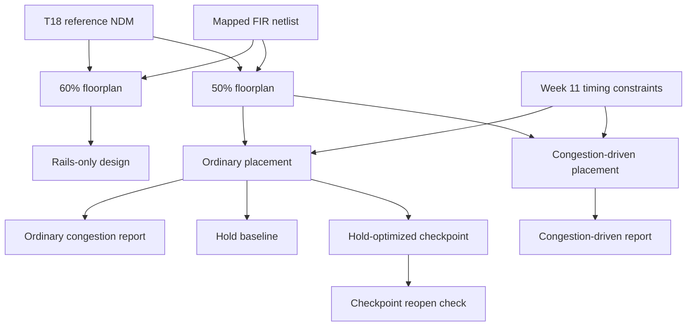

# Lab Automation

This guide explains execution order, checkpoint dependencies, and how the scripts handle failures. For file locations, editable inputs, and commands you can run on their own, see [Lab Files and Usage](files_and_usage.md).

## Execution Order

`bash run.sh` changes to the lab root, loads `config/default.env`, and clears `output/` and the generated `input/t18_typical.dnm/`.

| Order | Command or Action | Purpose |
| --- | --- | --- |
| 1 | Setup | Load configuration and clear the previous results and generated library. |
| 2 | `--mode preflight` | Discover installed tools and kit files. |
| 3 | `library` | Build the T18 reference library. |
| 4 | `floor` → offline A | Create the floorplans, then generate offline report A. |
| 5 | `rails` → offline B | Build the rails-only design, then generate offline report B. |
| 6 | `place` → offline C | Compare placement strategies, then generate offline report C. |
| 7 | `hold` → offline D | Compare hold-repair variants, then generate offline report D. |
| 8 | `reopen` | Verify that ICC2 can reopen the hold-optimized checkpoint under `output/5_reopen_checkpoint/`. |
| 9 | `collect_submission.py` | Create `Week12_submission.zip`. |

| Component | Responsibility |
| --- | --- |
| `run.sh` | Sets up the run and calls the next command only after the current command succeeds. |
| `scripts/run_icc2.py` | Validates stage inputs, prepares a working directory, invokes the stage Tcl script, and checks its log and artifacts. Library Manager runs the library build. ICC2 runs the design stages. |
| `scripts/run_lab.py` | Runs preflight discovery or invokes the Python models. The offline reports use teaching examples and student fixtures independently of the ICC2 checkpoints. |
| `scripts/collect_submission.py` | Builds the ZIP from student work and available offline reports. |

Library Manager runs in `output/0_build_reference_library/`. After the runner checks the build log and artifacts, it publishes the NDM to `input/t18_typical.dnm/` for ICC2. A failed build stops the wrapper before floorplanning.

## Checkpoint Dependencies

Arrows show which inputs or checkpoints a stage uses. The rails-only experiment is a separate branch. Placement starts from the 50% floorplan and builds its own power mesh.

Subsequent design stages copy the prerequisite `fir3.dlib` into their own working directory. The runner requires the prerequisite stage status to indicate that tool execution and artifact checks completed.

## Logs and Status

| Artifact or State | How to Read It |
| --- | --- |
| `output/1_A_create_floorplans/inputs.json` | Records the input paths and checksums after floorplanning. |
| `icc2.log` | Captures the tool’s output and errors in each stage directory. The library stage captures Library Manager output here. |
| `EXECUTED_REVIEW_REQUIRED` | The tool returned successfully, printed the completion marker, and produced the expected artifacts. Review the timing and physical checks in the log. |
| `FAILED_OR_INCOMPLETE` | The stage did not finish its execution and artifact checks. Inspect its log when available and read the wrapper’s error message. |

The wrapper stops on the first failed command. Running it again clears the previous results and generated library. For individual stage commands and log inspection examples, see the [slide commands](SLIDE_COMMANDS.md).
