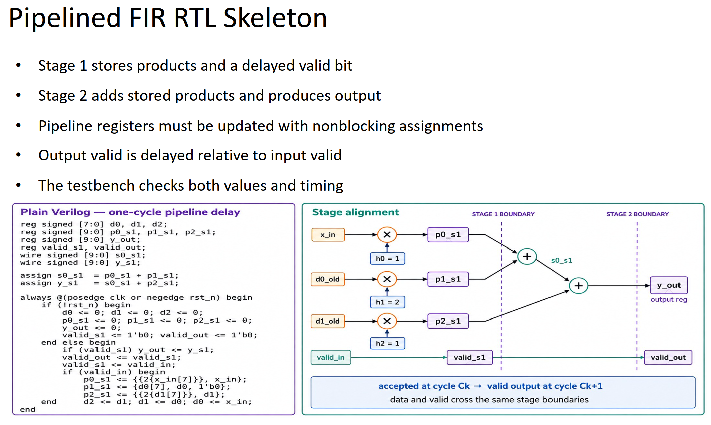
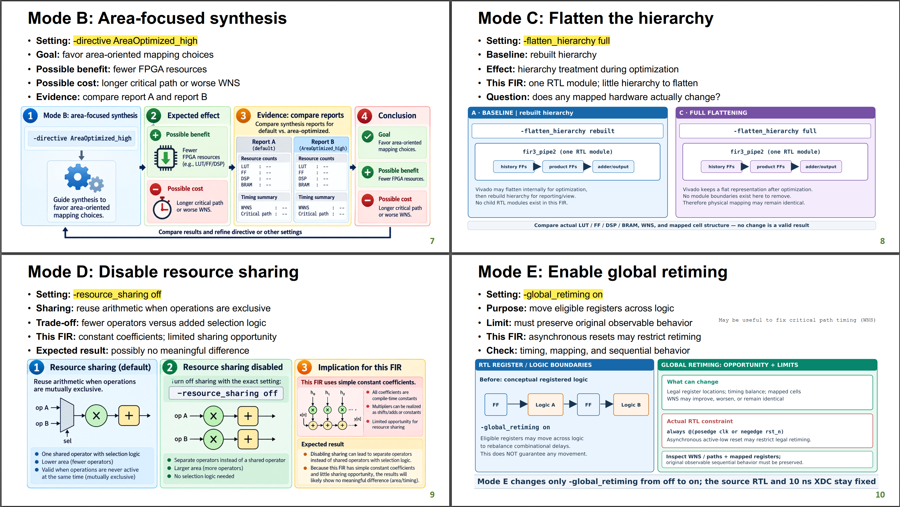

# Week 6. FIR Filter: Understanding FPGA Pre-route Synthesis Reports

## 1. Introduction

This project uses a small, signed, two-stage, three-tap FIR filter to
illustrate how Vivado synthesis reports describe an FPGA design. It focuses
on understanding resource and timing synthesis reports and comparing them
across five synthesis configurations. It also documents the design and
simulation flow and explains the main utilization and timing reports using
excerpts from the baseline run.

The RTL includes `d2`, which is optimized out during synthesis. Also,
post-synthesis timing uses estimated nets; Week 7 checks routed timing.

## 2. Reproduction Flow

1. Run the regression before synthesis:

```bash
$ ./scripts/run_xsim_regression.sh
```

Expected final marker: `[RESULT] WEEK6 INCLASS FIR REGRESSIONS PASSED`.
Check `waves/fir3_pipe2.vcd` and `waves/fir3_pipe2_signed.vcd`.
**Do not run synthesis if the simulation regression fails.**

The simulation regression script uses three core XSim commands:

- `xvlog` compiles the RTL and the selected Verilog testbench.
- `xelab` elaborates the compiled design and creates a simulation snapshot.
- `xsim` runs the snapshot and produces the test results and waveform.

2. Run the controlled synthesis configuration experiments

```bash
$ ./scripts/run_synth_modes.sh A B C D E
```

The synthesis script runs Vivado in batch mode for each selected mode. Its
core Vivado commands are:

- `read_verilog` loads `rtl/fir3_pipe2.v` into the synthesis flow.
- `read_xdc` loads the 10 ns clock constraint from
  `constraints/fir3_pipe2.xdc`.
- `synth_design` elaborates and optimizes the RTL using the selected mode
  options.

The synthesis log reports that the unused `d2_reg` sequential element was
removed:

```text
WARNING: [Synth 8-6014] Unused sequential element d2_reg was removed. [/home/kaiden/EDA/w6/rtl/fir3_pipe2.v:36]
```

This corresponds to the RTL signal `d2`: it exists in the source but is not
consumed by the FIR datapath, so synthesis removes the associated hardware.
The warning is useful evidence that synthesis has optimized away logic that
does not affect any output.

The synthesis flow then checks timing coverage, writes utilization and timing
reports, saves the ten worst setup paths, and writes a post-synthesis
checkpoint.

## 3. Design and Verification

<p align="center"></p>

`rtl/fir3_pipe2.v` is the same pipelined FIR design used in Week 5. It is a
three-tap signed FIR filter with coefficients `[1, 2, 1]`. The design
sign-extends each 8-bit input sample to 10 bits and maintains a short history
of accepted samples so it can calculate the weighted sum:

```text
y[n] = x[n] + 2x[n-1] + x[n-2]
```

The datapath is divided into two clocked stages. Stage 1 captures the current
sample history and the three coefficient products. Stage 2 adds the registered
products and registers the output. The `valid_in` signal controls when a
sample is accepted, and `valid_out` indicates when the corresponding
pipeline result is available. Invalid input cycles hold the datapath state and
do not advance the sample history.

The project uses two self-checking testbenches:

- `tb/tb_fir3_pipe2.v` checks normal FIR operation, pipeline latency, and
  invalid bubbles between accepted samples.
- `tb/tb_fir3_pipe2_signed.v` checks signed boundary behavior using `-128` and
  verifies the corresponding negative FIR results.

- PYNQ-Z2 FPGA target `xc7z020clg400-1`; source XDC is the uploaded Week 6 `constraints/fir3_pipe2.xdc` (10 ns clock).
- RTL top `fir3_pipe2`, simulation tops `tb_fir3_pipe2`, `tb_fir3_pipe2_signed`.

## 4. Understanding Synthesis Reports

The following report excerpts are from the baseline synthesis, mode A, in
`reports/A/`. The report-producing Tcl commands and the information available
from each report are:

| Report | Generating Tcl command | What it shows |
|---|---|---|
| `utilization.rpt` | `report_utilization` | FPGA resource usage and the resources inferred after synthesis. |
| `check_timing.rpt` | `check_timing` | Timing coverage and constraint problems that can make timing results incomplete. |
| `timing_summary.rpt` | `report_timing_summary -delay_type min_max -report_unconstrained` | Setup, hold, pulse-width, clock, path-group, and unconstrained-path results. |
| `worst10_setup_paths.rpt` | `report_timing -delay_type max -max_paths 10 -nworst 1` | Ten detailed worst setup paths. |

### 4.1 `utilization.rpt`

The report begins with the synthesized design and device, then summarizes
slice logic in one complete table:

```text
Utilization Design Information

1. Slice Logic
--------------
+-------------------------+------+-------+------------+-----------+-------+
|        Site Type        | Used | Fixed | Prohibited | Available | Util% |
+-------------------------+------+-------+------------+-----------+-------+
| Slice LUTs*             |   11 |     0 |          0 |     53200 |  0.02 |
|   LUT as Logic          |   11 |     0 |          0 |     53200 |  0.02 |
|   LUT as Memory         |    0 |     0 |          0 |     17400 |  0.00 |
| Slice Registers         |   36 |     0 |          0 |    106400 |  0.03 |
|   Register as Flip Flop |   36 |     0 |          0 |    106400 |  0.03 |
|   Register as Latch     |    0 |     0 |          0 |    106400 |  0.00 |
| F7 Muxes                |    0 |     0 |          0 |     26600 |  0.00 |
| F8 Muxes                |    0 |     0 |          0 |     13300 |  0.00 |
| Unique Control Sets     |    3 |       |          0 |     13300 |  0.02 |
+-------------------------+------+-------+------------+-----------+-------+
```

`Used` is the number of resources consumed, `Available` is the number on the
target device, and `Util%` is the percentage used. `Fixed` and `Prohibited`
show resources that are respectively locked in place or unavailable to the
implementation. The design uses 11 LUTs and 36 slice registers, all registers
are implemented as flip-flops rather than latches, and the three unique
control sets reflect the clock, reset, and enable combinations inferred from
the RTL.

The complete register-control table is:

```text
1.1 Summary of Registers by Type
--------------------------------

+-------+--------------+-------------+--------------+
| Total | Clock Enable | Synchronous | Asynchronous |
+-------+--------------+-------------+--------------+
| 0     |            _ |           - |            - |
| 0     |            _ |           - |          Set |
| 0     |            _ |           - |        Reset |
| 0     |            _ |         Set |            - |
| 0     |            _ |       Reset |            - |
| 0     |          Yes |           - |            - |
| 0     |          Yes |           - |          Set |
| 36    |          Yes |           - |        Reset |
| 0     |          Yes |         Set |            - |
| 0     |          Yes |       Reset |            - |
+-------+--------------+-------------+--------------+
```

This table classifies the 36 registers by clock-enable, synchronous-control,
and asynchronous-control behavior. All 36 have a clock enable and an
asynchronous reset; none uses a synchronous set or reset, and no other
register-control combination is present. The complete memory and DSP tables
are:

```text
2. Memory
---------

+----------------+------+-------+------------+-----------+-------+
|    Site Type   | Used | Fixed | Prohibited | Available | Util% |
+----------------+------+-------+------------+-----------+-------+
| Block RAM Tile |    0 |     0 |          0 |       140 |  0.00 |
|   RAMB36/FIFO* |    0 |     0 |          0 |       140 |  0.00 |
|   RAMB18       |    0 |     0 |          0 |       280 |  0.00 |
+----------------+------+-------+------------+-----------+-------+
```

The memory table separates block-RAM tiles from the RAMB36/FIFO and RAMB18
resources that can occupy them. Every `Used` value is zero, so this FIR does
not infer or consume block RAM.

```text
3. DSP
------

+-----------+------+-------+------------+-----------+-------+
| Site Type | Used | Fixed | Prohibited | Available | Util% |
+-----------+------+-------+------------+-----------+-------+
| DSPs      |    0 |     0 |          0 |       220 |  0.00 |
+-----------+------+-------+------------+-----------+-------+
```

The DSP table reports the number of dedicated DSP slices used, along with the
device capacity. The zero count shows that the FIR arithmetic was mapped to
LUTs and `CARRY4` primitives instead of dedicated DSP blocks.

The complete I/O table reports 22 ordinary bonded I/O blocks:

```text
4. IO and GT Specific
---------------------

+-----------------------------+------+-------+------------+-----------+-------+
|          Site Type          | Used | Fixed | Prohibited | Available | Util% |
+-----------------------------+------+-------+------------+-----------+-------+
| Bonded IOB                  |   22 |     0 |          0 |       125 | 17.60 |
| Bonded IPADs                |    0 |     0 |          0 |         2 |  0.00 |
| Bonded IOPADs               |    0 |     0 |          0 |       130 |  0.00 |
| PHY_CONTROL                 |    0 |     0 |          0 |         4 |  0.00 |
| PHASER_REF                  |    0 |     0 |          0 |         4 |  0.00 |
| OUT_FIFO                    |    0 |     0 |          0 |        16 |  0.00 |
| IN_FIFO                     |    0 |     0 |          0 |        16 |  0.00 |
| IDELAYCTRL                  |    0 |     0 |          0 |         4 |  0.00 |
| IBUFDS                      |    0 |     0 |          0 |       121 |  0.00 |
| PHASER_OUT/PHASER_OUT_PHY   |    0 |     0 |          0 |        16 |  0.00 |
| PHASER_IN/PHASER_IN_PHY     |    0 |     0 |          0 |        16 |  0.00 |
| IDELAYE2/IDELAYE2_FINEDELAY |    0 |     0 |          0 |       200 |  0.00 |
| ILOGIC                      |    0 |     0 |          0 |       125 |  0.00 |
| OLOGIC                      |    0 |     0 |          0 |       125 |  0.00 |
+-----------------------------+------+-------+------------+-----------+-------+
```

The I/O table covers the device's input, output, delay, FIFO, and interface
resources. Only 22 bonded IOBs are used, corresponding to the top-level
ports; the differential, delay, FIFO, and other specialized I/O resources are
unused.

The complete clocking table reports one global clock buffer:

```text
5. Clocking
-----------

+------------+------+-------+------------+-----------+-------+
|  Site Type | Used | Fixed | Prohibited | Available | Util% |
+------------+------+-------+------------+-----------+-------+
| BUFGCTRL   |    1 |     0 |          0 |        32 |  3.13 |
| BUFIO      |    0 |     0 |          0 |        16 |  0.00 |
| MMCME2_ADV |    0 |     0 |          0 |         4 |  0.00 |
| PLLE2_ADV  |    0 |     0 |          0 |         4 |  0.00 |
| BUFMRCE    |    0 |     0 |          0 |         8 |  0.00 |
| BUFHCE     |    0 |     0 |          0 |        72 |  0.00 |
| BUFR       |    0 |     0 |          0 |        16 |  0.00 |
+------------+------+-------+------------+-----------+-------+
```

The clocking table lists global, regional, and mixed-mode clock resources.
One `BUFGCTRL` is used to distribute `clk`; no additional clock-management
blocks or regional clock buffers are required by this design.

The complete primitive summary is:

```text
7. Primitives
-------------

+----------+------+---------------------+
| Ref Name | Used | Functional Category |
+----------+------+---------------------+
| FDCE     |   36 | Flop & Latch        |
| OBUF     |   11 | IO                  |
| IBUF     |   11 | IO                  |
| LUT3     |    8 | LUT                 |
| LUT4     |    6 | LUT                 |
| CARRY4   |    3 | CarryLogic          |
| LUT5     |    1 | LUT                 |
| LUT2     |    1 | LUT                 |
| LUT1     |    1 | LUT                 |
| BUFG     |    1 | Clock               |
+----------+------+---------------------+
```

This summary gives the post-synthesis primitive-level implementation. The
36 `FDCE` instances implement the registers, the `IBUF` and `OBUF` instances
connect the 22 top-level ports, the LUTs implement logic, and the three
`CARRY4` instances implement the adder carry chains. The `BUFG` distributes
the clock. The primitive counts provide a more specific breakdown than the
aggregate slice totals above.

### 4.2 `check_timing.rpt`

The report checks clocking, timing coverage, delay constraints, and loops:

```text
1. checking no_clock (0)
2. checking constant_clock (0)
3. checking pulse_width_clock (0)
4. checking unconstrained_internal_endpoints (0)
5. checking no_input_delay (10)
6. checking no_output_delay (11)
7. checking multiple_clock (0)
8. checking generated_clocks (0)
9. checking loops (0)
10. checking partial_input_delay (0)
11. checking partial_output_delay (0)
12. checking latch_loops (0)
```

Each numbered check reports the number of endpoints or conditions found for
that check. The zero values show that the design has no missing clock,
multiple-clock, generated-clock, loop, or partial-delay problems. The
nonzero `no_input_delay` and `no_output_delay` counts identify the missing
external interface constraints.

Because this education project does not define `set_input_delay` or
`set_output_delay`, the report specifically says:

```text
There are 9 input ports with no input delay specified. (HIGH)
There are 11 ports with no output delay specified. (HIGH)
```

The two warning lines give the affected port counts. The internal clock and
loop checks pass, but external I/O timing is not fully modeled because input
arrival times and output required times have not been specified.

### 4.3 `timing_summary.rpt`

The timing-summary report includes the complete `check_timing` report at its
beginning. It then reports the timer settings and both slow and fast corners:

```text
Corner  Analyze    Analyze
Name    Max Paths  Min Paths
------  ---------  ---------
Slow    Yes        Yes
Fast    Yes        Yes
```

This corner table shows that both the maximum-delay analysis used for setup
checks and the minimum-delay analysis used for hold checks run at both the
slow and fast process corners.

The report's design timing summary is:

```text
------------------------------------------------------------------------------------------------
| Design Timing Summary
| ---------------------
------------------------------------------------------------------------------------------------

    WNS(ns)      TNS(ns)  TNS Failing Endpoints  TNS Total Endpoints      WHS(ns)      THS(ns)  THS Failing Endpoints  THS Total Endpoints     WPWS(ns)     TPWS(ns)  TPWS Failing Endpoints  TPWS Total Endpoints
    -------      -------  ---------------------  -------------------      -------      -------  ---------------------  -------------------     --------     --------  ----------------------  --------------------
      6.642        0.000                      0                   37        0.156        0.000                      0                   37        4.500        0.000                       0                    37

------------------------------------------------------------------------------------------------
| Design Timing Summary
| ---------------------
------------------------------------------------------------------------------------------------

    WNS(ns)      TNS(ns)  TNS Failing Endpoints  TNS Total Endpoints      WHS(ns)      THS(ns)  THS Failing Endpoints  THS Total Endpoints     WPWS(ns)     TPWS(ns)  TPWS Failing Endpoints  TPWS Total Endpoints  
    -------      -------  ---------------------  -------------------      -------      -------  ---------------------  -------------------     --------     --------  ----------------------  --------------------  
      6.642        0.000                      0                   37        0.156        0.000                      0                   37        4.500        0.000                       0                    37  


All user specified timing constraints are met.
```

The summary columns report worst negative slack (`WNS`/`WHS`), total negative
slack (`TNS`/`THS`), and pulse-width equivalents (`WPWS`/`TPWS`). The failing
endpoint columns count violations, while the total endpoint columns show the
number of checked endpoints. Here, 37 endpoints are checked for each class,
there are no failing endpoints, and all total violations are zero. The
positive WNS, WHS, and WPWS values therefore indicate passing setup, hold, and
pulse-width checks for the constrained internal paths.

The clock summary and intra-clock table are:

```text
Clock  Waveform(ns)       Period(ns)      Frequency(MHz)
-----  ------------       ----------      --------------
clk    {0.000 5.000}      10.000          100.000

------------------------------------------------------------------------------------------------
| Intra Clock Table
| -----------------
------------------------------------------------------------------------------------------------

Clock             WNS(ns)      TNS(ns)  TNS Failing Endpoints  TNS Total Endpoints      WHS(ns)      THS(ns)  THS Failing Endpoints  THS Total Endpoints     WPWS(ns)     TPWS(ns)  TPWS Failing Endpoints  TPWS Total Endpoints
-----             -------      -------  ---------------------  -------------------      -------      -------  ---------------------  -------------------     --------     --------  ----------------------  --------------------
clk                 6.642        0.000                      0                   37        0.156        0.000                      0                   37        4.500        0.000                       0                    37
```

The clock summary identifies `clk` as a 100 MHz clock with a 10 ns period and
a 5 ns high phase. The intra-clock row groups all paths launched and captured
by that clock and repeats the setup, hold, and pulse-width metrics for that
clock domain.

The first maximum-delay path is a setup check. The complete table from the
report is:

```text
Max Delay Paths
--------------------------------------------------------------------------------------
Slack (MET) :             6.642ns  (required time - arrival time)
  Source:                 p1_s1_reg[2]/C
                            (rising edge-triggered cell FDCE clocked by clk  {rise@0.000ns fall@5.000ns period=10.000ns})
  Destination:            y_out_reg[9]/D
                            (rising edge-triggered cell FDCE clocked by clk  {rise@0.000ns fall@5.000ns period=10.000ns})
  Path Group:             clk
  Path Type:              Setup (Max at Slow Process Corner)
  Requirement:            10.000ns  (clk rise@10.000ns - clk rise@0.000ns)
  Data Path Delay:        3.254ns  (logic 1.963ns (60.326%)  route 1.291ns (39.674%))
  Logic Levels:           5  (CARRY4=3 LUT3=1 LUT4=1)
  Clock Path Skew:        -0.145ns (DCD - SCD + CPR)
    Destination Clock Delay (DCD):    2.128ns = ( 12.128 - 10.000 ) 
    Source Clock Delay      (SCD):    2.456ns
    Clock Pessimism Removal (CPR):    0.184ns
  Clock Uncertainty:      0.035ns  ((TSJ^2 + TIJ^2)^1/2 + DJ) / 2 + PE
    Total System Jitter     (TSJ):    0.071ns
    Total Input Jitter      (TIJ):    0.000ns
    Discrete Jitter          (DJ):    0.000ns
    Phase Error              (PE):    0.000ns

    Location             Delay type                Incr(ns)  Path(ns)    Netlist Resource(s)
  -------------------------------------------------------------------    -------------------
                         (clock clk rise edge)        0.000     0.000 r  
                                                      0.000     0.000 r  clk (IN)
                         net (fo=0)                   0.000     0.000    clk
                         IBUF (Prop_ibuf_I_O)         0.972     0.972 r  clk_IBUF_inst/O
                         net (fo=1, unplaced)         0.800     1.771    clk_IBUF
                         BUFG (Prop_bufg_I_O)         0.101     1.872 r  clk_IBUF_BUFG_inst/O
                         net (fo=36, unplaced)        0.584     2.456    clk_IBUF_BUFG
                         FDCE                                         r  p1_s1_reg[2]/C
  -------------------------------------------------------------------    -------------------
                         FDCE (Prop_fdce_C_Q)         0.478     2.934 r  p1_s1_reg[2]/Q
                         net (fo=4, unplaced)         0.765     3.699    p1_s1[2]
                         LUT3 (Prop_lut3_I0_O)        0.324     4.023 r  y_out[3]_i_2/O
                         net (fo=2, unplaced)         0.517     4.540    y_out[3]_i_2_n_0
                         LUT4 (Prop_lut4_I3_O)        0.331     4.871 r  y_out[3]_i_4/O
                         net (fo=1, unplaced)         0.000     4.871    y_out[3]_i_4_n_0
                         CARRY4 (Prop_carry4_S[3]_CO[3])
                                                      0.376     5.247 r  y_out_reg[3]_i_1/CO[3]
                         net (fo=1, unplaced)         0.009     5.256    y_out_reg[3]_i_1_n_0
                         CARRY4 (Prop_carry4_CI_CO[3])
                                                      0.117     5.373 r  y_out_reg[7]_i_1/CO[3]
                         net (fo=1, unplaced)         0.000     5.373    y_out_reg[7]_i_1_n_0
                         CARRY4 (Prop_carry4_CI_O[1])
                                                      0.337     5.710 r  y_out_reg[9]_i_1/O[1]
                         net (fo=1, unplaced)         0.000     5.710    y_s1[9]
                         FDCE                                         r  y_out_reg[9]/D
  -------------------------------------------------------------------    -------------------

                         (clock clk rise edge)       10.000    10.000 r  
                                                      0.000    10.000 r  clk (IN)
                         net (fo=0)                   0.000    10.000    clk
                         IBUF (Prop_ibuf_I_O)         0.838    10.838 r  clk_IBUF_inst/O
                         net (fo=1, unplaced)         0.760    11.598    clk_IBUF
                         BUFG (Prop_bufg_I_O)         0.091    11.689 r  clk_IBUF_BUFG_inst/O
                         net (fo=36, unplaced)        0.439    12.128    clk_IBUF_BUFG
                         FDCE                                         r  y_out_reg[9]/C
                         clock pessimism              0.184    12.311    
                         clock uncertainty           -0.035    12.276    
                         FDCE (Setup_fdce_C_D)        0.076    12.352    y_out_reg[9]
  -------------------------------------------------------------------
                         required time                         12.352    
                         arrival time                          -5.710    
  -------------------------------------------------------------------
                         slack                                  6.642    
```

The path header identifies the launch and capture pins, path group, corner,
clock requirement, data delay, and clock adjustments. In the detailed trace,
`Incr(ns)` is the delay added by the current cell or net, `Path(ns)` is the
running arrival time, and `Netlist Resource(s)` names the implementation
element contributing that delay. The two clock sections show the launch and
capture clock propagation separately from the data section.

This path launches data from `p1_s1_reg[2]`, propagates through two LUTs and
three `CARRY4` arithmetic resources, and captures it at `y_out_reg[9]`. The
data delay is `3.254 ns`: `1.963 ns` through logic and `1.291 ns` through
routing. It is a maximum-delay setup check at the slow corner, where delay is
most unfavorable. The path meets the 10 ns clock requirement with `6.642 ns`
slack. Vivado uses `slack = required time - arrival time`; the negative
arrival entry is the signed contribution used in that equation, not a
negative physical delay.

The clock adjustments show how source and destination clock arrival times are
compared. `DCD` is destination clock delay, `SCD` is source clock delay, and
`CPR` is clock pessimism removal:

```text
Clock Path Skew:        -0.145ns (DCD - SCD + CPR)
Clock Uncertainty:       0.035ns
Total System Jitter:     0.071ns
```

Clock uncertainty reserves margin for jitter and phase variation. Vivado uses
the report's formula `((TSJ^2 + TIJ^2)^1/2 + DJ) / 2 + PE`.

The first minimum-delay path is a hold check. The complete table from the
report is:

```text
Min Delay Paths
--------------------------------------------------------------------------------------
Slack (MET) :             0.156ns  (arrival time - required time)
  Source:                 p1_s1_reg[9]/C
                            (rising edge-triggered cell FDCE clocked by clk  {rise@0.000ns fall@5.000ns period=10.000ns})
  Destination:            p2_s1_reg[8]/D
                            (rising edge-triggered cell FDCE clocked by clk  {rise@0.000ns fall@5.000ns period=10.000ns})
  Path Group:             clk
  Path Type:              Hold (Min at Fast Process Corner)
  Requirement:            0.000ns  (clk rise@0.000ns - clk rise@0.000ns)
  Data Path Delay:        0.292ns  (logic 0.147ns (50.269%)  route 0.145ns (49.731%))
  Logic Levels:           0  
  Clock Path Skew:        0.145ns (DCD - SCD - CPR)
    Destination Clock Delay (DCD):    1.032ns
    Source Clock Delay      (SCD):    0.678ns
    Clock Pessimism Removal (CPR):    0.210ns

    Location             Delay type                Incr(ns)  Path(ns)    Netlist Resource(s)
  -------------------------------------------------------------------    -------------------
                         (clock clk rise edge)        0.000     0.000 r  
                                                      0.000     0.000 r  clk (IN)
                         net (fo=0)                   0.000     0.000    clk
                         IBUF (Prop_ibuf_I_O)         0.200     0.200 r  clk_IBUF_inst/O
                         net (fo=1, unplaced)         0.337     0.538    clk_IBUF
                         BUFG (Prop_bufg_I_O)         0.026     0.564 r  clk_IBUF_BUFG_inst/O
                         net (fo=36, unplaced)        0.114     0.678    clk_IBUF_BUFG
                         FDCE                                         r  p1_s1_reg[9]/C
  -------------------------------------------------------------------    -------------------
                         FDCE (Prop_fdce_C_Q)         0.147     0.825 r  p1_s1_reg[9]/Q
                         net (fo=2, unplaced)         0.145     0.970    p1_s1[9]
                         FDCE                                         r  p2_s1_reg[8]/D
  -------------------------------------------------------------------    -------------------

                         (clock clk rise edge)        0.000     0.000 r  
                                                      0.000     0.000 r  clk (IN)
                         net (fo=0)                   0.000     0.000    clk
                         IBUF (Prop_ibuf_I_O)         0.389     0.389 r  clk_IBUF_inst/O
                         net (fo=1, unplaced)         0.355     0.744    clk_IBUF
                         BUFG (Prop_bufg_I_O)         0.029     0.773 r  clk_IBUF_BUFG_inst/O
                         net (fo=36, unplaced)        0.259     1.032    clk_IBUF_BUFG
                         FDCE                                         r  p2_s1_reg[8]/C
                         clock pessimism             -0.210     0.823    
                         FDCE (Hold_fdce_C_D)        -0.009     0.814    p2_s1_reg[8]
  -------------------------------------------------------------------
                         required time                         -0.814    
                         arrival time                           0.970    
  -------------------------------------------------------------------
                         slack                                  0.156    
```

The hold-path header and trace use the same `Incr(ns)`, `Path(ns)`, and
resource columns as the setup table, but the data and capture-clock traces
are compared at the same clock edge. The negative hold-cell delay shown in
the capture section is part of the library timing model and is included when
Vivado calculates the effective hold requirement.

This path is analyzed at the fast corner because hold failures occur when
data moves too quickly. The trace can be read in three stages:

1. The launch clock reaches `p1_s1_reg[9]/C` at `0.678 ns`. The launching
   `FDCE` then changes its `Q` output after `0.147 ns`, bringing the data to
   `0.825 ns`. The following net adds `0.145 ns`, so the data reaches
   `p2_s1_reg[8]/D` at `0.970 ns`. There are no LUT or carry levels on this
   path; it is a direct register-to-register connection.
2. The capture clock reaches `p2_s1_reg[8]/C` at `1.032 ns`. Vivado applies
   `0.210 ns` of clock-pessimism removal, giving the clock-path value
   `0.823 ns`, and then applies the destination flip-flop hold delay of
   `-0.009 ns`, giving the effective endpoint value `0.814 ns`.
3. The report displays the hold endpoint as `required time -0.814 ns` because
   of its hold-path sign convention. The corresponding positive effective
   hold requirement is `0.814 ns`, so the data margin is
   `0.970 - 0.814 = 0.156 ns`, matching the reported slack. Thus the path
   passes, but it has much less margin than the `6.642 ns` setup path.

For hold timing, Vivado reports `slack = arrival time - required time` using
this hold-path convention. The `0.292 ns` data delay is the sum of the
`0.147 ns` flip-flop propagation delay and `0.145 ns` net delay; the positive
slack means the new data does not violate the destination flip-flop's hold
window.

For this hold path, the report gives clock skew as
`DCD - SCD - CPR = 1.032 - 0.678 - 0.210 = 0.145 ns`. The positive skew
increases the available hold margin because the destination clock arrives
later than the launch clock after pessimism removal. Unlike the setup excerpt,
this hold path has no separate clock-uncertainty block in the report.

The complete pulse-width table is:

```text
Pulse Width Checks
--------------------------------------------------------------------------------------
Clock Name:         clk
Waveform(ns):       { 0.000 5.000 }
Period(ns):         10.000
Sources:            { clk }

Check Type        Corner  Lib Pin  Reference Pin  Required(ns)  Actual(ns)  Slack(ns)  Location  Pin
Min Period        n/a     BUFG/I   n/a            2.155         10.000      7.845                clk_IBUF_BUFG_inst/I
Low Pulse Width   Slow    FDCE/C   n/a            0.500         5.000       4.500                d0_reg[0]/C
High Pulse Width  Slow    FDCE/C   n/a            0.500         5.000       4.500                d0_reg[0]/C
```

The table compares the minimum period and the low- and high-pulse-width
requirements for `clk`. `Required(ns)` is the minimum legal value, `Actual(ns)`
is the measured period or pulse width, and `Slack(ns)` is the remaining
margin. The 10 ns period exceeds the 2.155 ns minimum-period requirement by
7.845 ns, while both 5 ns half-cycles exceed the 0.5 ns pulse-width
requirement by 4.5 ns. The `Corner` column identifies the process corner used
for each check, and the library pin and location columns identify the clock
primitive and endpoint being checked.

The minimum-period check passes by `7.845 ns`. The clock's low and high
pulses are each `5 ns`, exceeding the required `0.5 ns` by `4.5 ns`.

The unconstrained path table is reported below these timing sections. An
unconstrained path can show infinite slack because no finite I/O timing
requirement was supplied; this means it was not fully timed, not that it was
proven safe.

### 4.4 `worst10_setup_paths.rpt`

This report contains ten detailed setup-path tables in the same format as the
first maximum-delay path in `timing_summary.rpt`. The mode-A slacks are:

```text
6.642 ns, 6.747 ns, 6.759 ns, 6.765 ns, 6.840 ns,
6.864 ns, 7.226 ns, 7.786 ns, 8.134 ns, 8.383 ns
```

Each value is the setup slack for one of the ten reported paths, ordered from
the smallest margin to the largest. The first entry is therefore the critical
path and matches the `6.642 ns` maximum-delay path in
`timing_summary.rpt`. The remaining values show how much additional setup
margin is available on the next nine paths; the detailed tables contain their
source and destination registers, logic levels, routing delay, clock effects,
and required and arrival times.

## 5. Result

This three-tap sequential FIR is a fairly small design. Its datapath contains
only a few registers, LUTs, and carry-chain additions, so changing synthesis
options may have no observable impact on the synthesized result. The
comparison must therefore use the generated logs and reports rather than
assuming that an option produces a difference.

### 5.1 Synthesis Variations

<p align="center"></p>

| Mode | Synthesis option | Expected impact |
|---|---|---|
| A | Default settings | Reference implementation for all comparisons |
| B | `-directive AreaOptimized_high` | Tests area-oriented optimization against timing |
| C | `-flatten_hierarchy full` | Tests whether complete hierarchy visibility changes optimization |
| D | `-resource_sharing off` | Tests the cost of disabling arithmetic sharing |
| E | `-global_retiming on` | Tests whether register movement improves timing |

Each mode change exactly one synthesis setting.

### 5.2 Resource Comparison

| Mode | FDCE | OBUF | IBUF | LUT1 | LUT2 | LUT3 | LUT4 | LUT5 | CARRY4 | BRAM | DSP |
|---|---:|---:|---:|---:|---:|---:|---:|---:|---:|---:|---:|
| A | 36 | 11 | 11 | 1 | 1 | 8 | 6 | 1 | 3 | 0 | 0 |
| B | 36 | 11 | 11 | 1 | 1 | 8 | 6 | 1 | 3 | 0 | 0 |
| C | 36 | 11 | 11 | 1 | 1 | 8 | 6 | 1 | 3 | 0 | 0 |
| D | 36 | 11 | 11 | 1 | 1 | 8 | 6 | 1 | 3 | 0 | 0 |
| E | 36 | 11 | 11 | 1 | 1 | 8 | 6 | 1 | 3 | 0 | 0 |

Observations: 

- All modes use 36 `FDCE` flip-flops, 11 `OBUF` instances, and 11 `IBUF`
  instances.
- The LUT primitive breakdown is identical: one `LUT1`, one `LUT2`, eight
  `LUT3`, six `LUT4`, and one `LUT5`.
- All modes use three `CARRY4` arithmetic primitives.
- No mode uses block RAM or DSP resources; the I/O primitives account for the
  design's external ports.
- The identical resource counts show no observable resource impact from the
  tested options.

### 5.3 Timing Comparison

| Mode | WNS (ns) | TNS (ns) | WHS (ns) | THS (ns) | WPWS (ns) | TPWS (ns) |
|---|---:|---:|---:|---:|---:|---:|
| A | 6.642 | 0.000 | 0.156 | 0.000 | 4.500 | 0.000 |
| B | 6.642 | 0.000 | 0.156 | 0.000 | 4.500 | 0.000 |
| C | 6.642 | 0.000 | 0.156 | 0.000 | 4.500 | 0.000 |
| D | 6.642 | 0.000 | 0.156 | 0.000 | 4.500 | 0.000 |
| E | 6.642 | 0.000 | 0.156 | 0.000 | 4.500 | 0.000 |

Observations:

- All modes pass setup, hold, and pulse-width timing with zero total
  violation.
- WNS, TNS, WHS, THS, WPWS, and TPWS are identical across all modes.
- The timing reports therefore show no measurable timing benefit from the
  area-optimization directive, flattening, disabling resource sharing, or
  enabling global retiming.
- Every mode reports 9 inputs without input delays and 11 outputs without
  output delays, so external I/O timing remains unconstrained.

## 6. Conclusion

The five synthesis modes apply different optimization strategies: mode A uses
the default settings, mode B applies `AreaOptimized_high`, mode C enables full
hierarchy flattening, mode D disables resource sharing, and mode E enables
global retiming. For this small FIR, none of these options changes the
measured implementation. Every mode uses 36 `FDCE` registers, 11 LUTs, three
`CARRY4` primitives, 22 I/O buffers, no block RAM, and no DSP resources.
Likewise, every mode has the same timing results: WNS `6.642 ns`, TNS
`0.000 ns`, WHS `0.156 ns`, THS `0.000 ns`, WPWS `4.500 ns`, and TPWS
`0.000 ns`.

Going forward, synthesis reports should serve as evidence for design decisions
rather than assuming that an optimization option will improve the result.
Timing coverage and constraints should be checked first, followed by resource
counts, critical-path details, slack, and unconstrained paths across
controlled runs. In a serious project, input and output delays should also be
specified so that external interface paths are constrained and the static
timing analysis (STA) results are correct. This makes it possible to
distinguish a real improvement from a setting that has no observable effect,
identify missing constraints before trusting timing conclusions, and determine
when a larger or more complex design is needed to reveal an optimization
trade-off.
